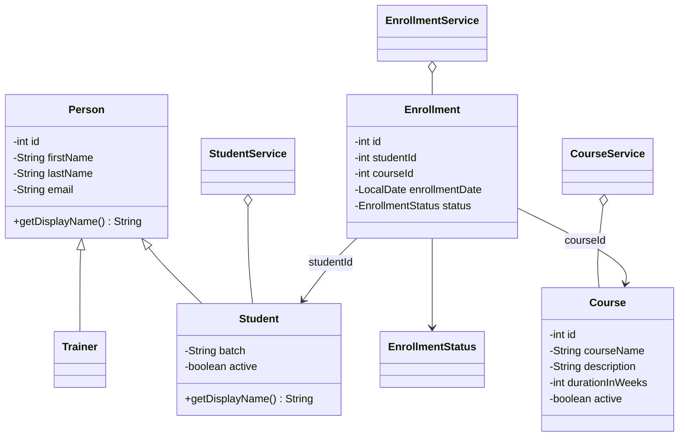

# LearnTrack

LearnTrack is a console-based Student & Course Management System built with Core Java. It manages students, courses, and enrollments in memory and is designed to demonstrate Java fundamentals, object-oriented programming, collections, and basic exception handling.

## Features

- Add, list, search, update, and deactivate students
- Add, list, search, and activate/deactivate courses
- Enroll students in courses
- View a student's enrollments
- Complete or cancel enrollments
- Graceful handling of invalid input and missing entities

## Project structure

```text
src/com/airtribe/learntrack/
├── entity/       Person, Student, Trainer, Course, Enrollment, EnrollmentStatus
├── exception/    EntityNotFoundException, InvalidInputException
├── service/      StudentService, CourseService, EnrollmentService
├── ui/           Main
└── util/         IdGenerator, InputValidator
docs/             Setup, JVM, and design notes
```

## Class diagram



## Compile and run

From the project root directory:

```bash
mkdir -p out
javac -d out $(find src -name "*.java")
java -cp out com.airtribe.learntrack.ui.Main
```

The application stores data only while it is running. Stop and restart the program to begin with empty lists.

## Documentation

- [Setup instructions](docs/Setup_Instructions.md)
- [JVM basics](docs/JVM_Basics.md)
- [Design notes](docs/Design_Notes.md)

